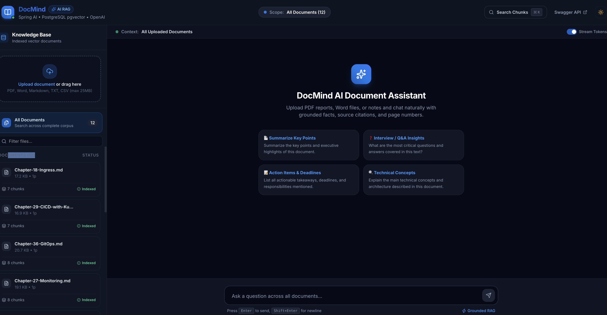
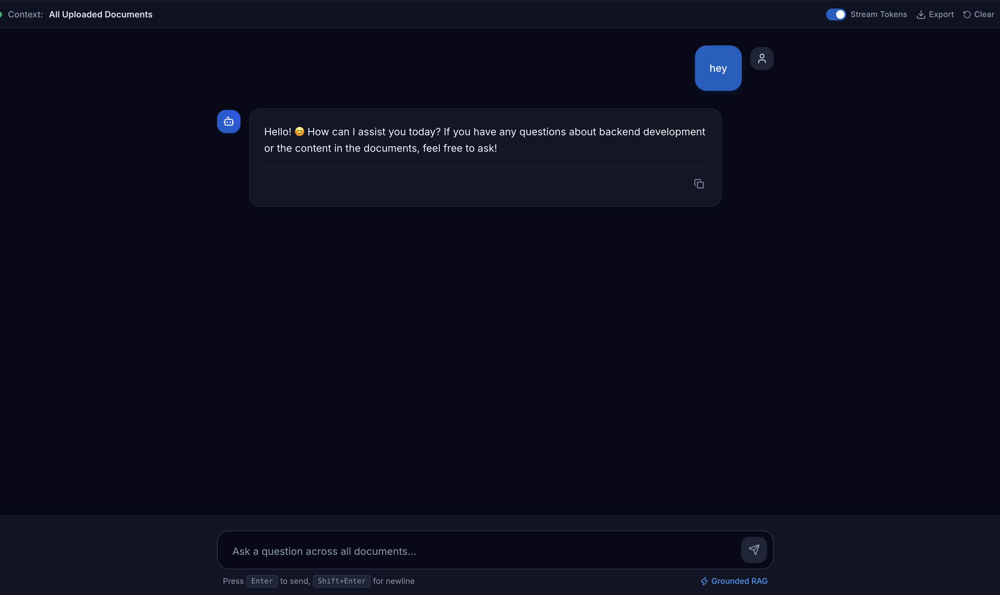
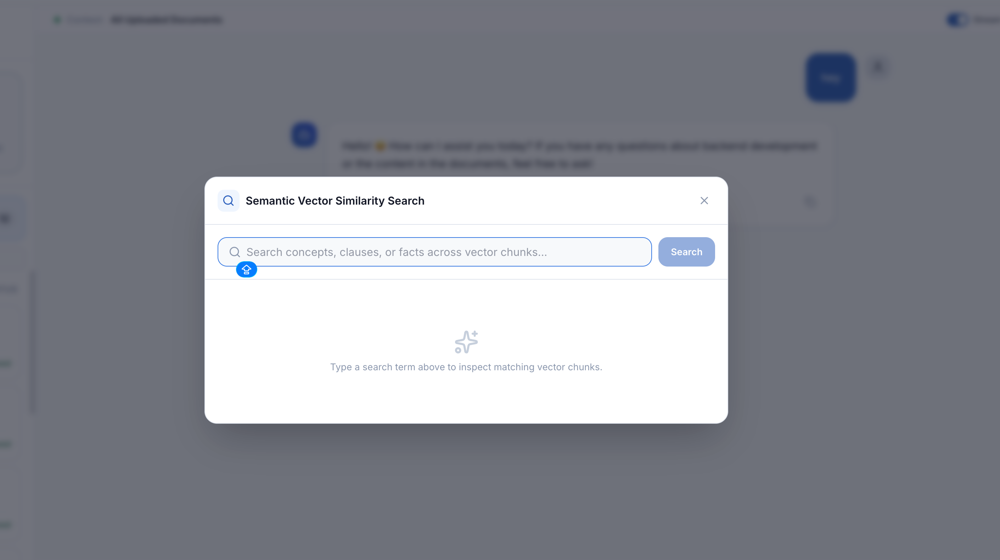
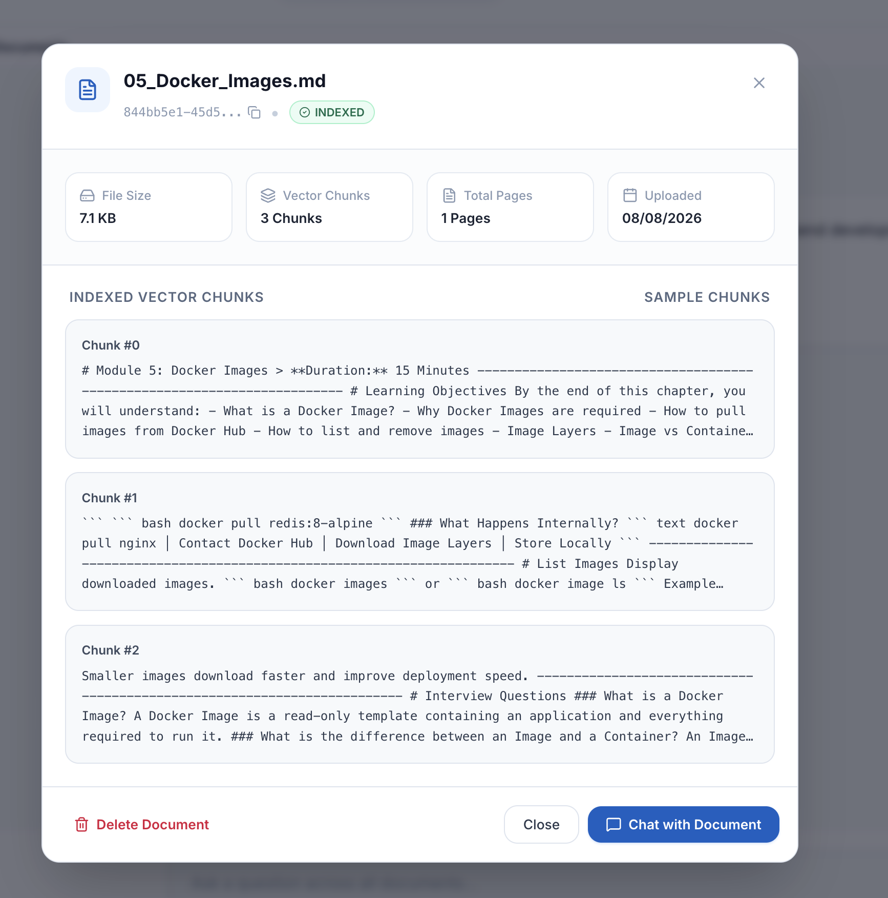
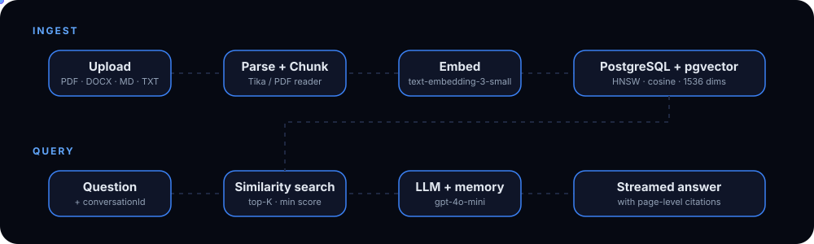

<div align="center">


<br/>

[](https://openjdk.org/)
[](https://spring.io/projects/spring-boot)
[](https://spring.io/projects/spring-ai)
[](https://github.com/pgvector/pgvector)
[](https://react.dev/)
[](https://tailwindcss.com/)

**Upload documents. Ask questions. Get grounded answers with page-level citations.**

[Features](#-features) · [How it works](#-how-it-works) · [Quick start](#-quick-start) · [API](#-api-reference) · [Configuration](#%EF%B8%8F-configuration) · [Structure](#-project-structure)

</div>

---

## ✨ Features

| | |
|---|---|
| 📄 **Multi-format ingestion** | PDF, Word, Markdown, TXT and CSV, parsed with Spring AI's PDF and Tika readers and split into chunks. |
| 🧠 **Retrieval-Augmented Generation** | Chunks are embedded and stored in PostgreSQL + **pgvector** (HNSW, cosine). Answers are grounded in your own content. |
| 🔖 **Source citations** | Every answer returns the file name, chunk index, page number, snippet and similarity score it was built from. |
| ⚡ **Streaming or classic** | Toggle token streaming on or off. The choice is remembered per user. |
| 💬 **Persistent chats** | Multiple conversations per user with conversation memory handled server-side. Switch, reload, delete. |
| 🔐 **Stateless JWT auth** | Register and login with Spring Security. Each user only sees their own documents. |
| 🔎 **Semantic chunk search** | Inspect exactly which vector chunks match a query (`⌘/Ctrl + K`), with tunable top-K and similarity threshold. |
| 🌗 **Dark and light UI** | React 19 + Tailwind 4 interface with drag-and-drop upload and live indexing progress. |
| 📚 **OpenAPI docs** | Swagger UI served by the backend at `/swagger-ui/index.html`. |

## 🖼 Screenshots

<div align="center">



<sub><b>Workspace</b>: knowledge base on the left, grounded chat on the right</sub>

<br/><br/>

<table>
  <tr>
    <td width="50%"><br/><sub><b>Streaming chat</b> with copy, export and clear</sub></td>
    <td width="50%"><br/><sub><b>Semantic search</b> over vector chunks</sub></td>
  </tr>
  <tr>
    <td colspan="2" align="center"><br/><sub><b>Document details</b>: status, size, pages and the indexed chunks</sub></td>
  </tr>
</table>

</div>

## 🔄 How it works

<div align="center">
  
</div>

1. **Ingest.** A file is uploaded, parsed, split into ~700-token chunks and embedded with `text-embedding-3-small`. The vectors are stored in `pgvector` with the file name and page number as metadata.
2. **Retrieve.** A question is embedded and matched against the store by cosine similarity (top-K, minimum score configurable), optionally scoped to one document.
3. **Generate.** The matched chunks and the conversation memory go to the chat model (`gpt-4o-mini` by default). The answer comes back as one response or as a token stream, together with its citations.

## 🧰 Tech stack

| Layer | Technology |
|---|---|
| Backend | Java 21, Spring Boot 4.1, Spring Web MVC, Spring Data JPA, Spring Security, springdoc-openapi |
| AI | Spring AI 2.0 (OpenAI chat and embeddings, vector-store advisor, PDF and Tika readers) |
| Data | PostgreSQL 16 + pgvector (HNSW index, 1536 dimensions) |
| Auth | JWT (jjwt), stateless, Bearer tokens |
| Frontend | React 19, Vite 8, Tailwind CSS 4, Zustand, React Router, Axios, react-hot-toast, lucide-react |

## 🚀 Quick start

### Prerequisites

- JDK 21
- Node.js 20+
- Docker (for PostgreSQL + pgvector)
- An [OpenAI API key](https://platform.openai.com/api-keys)

### 1. Start the database

```bash
docker compose up -d
```

This starts `pgvector/pgvector:pg16` on **localhost:5434** (database `docmind`, user and password `postgres`).

### 2. Run the backend

```bash
export OPENAI_API_KEY=sk-...
export JWT_SECRET=$(openssl rand -base64 48)   # strongly recommended; a dev default exists

./mvnw spring-boot:run
```

The API is now on **http://localhost:8081**, with Swagger UI at `/swagger-ui/index.html`.

### 3. Run the frontend

```bash
cd frontend
npm install
npm run dev
```

Open **http://localhost:5173**. The dev server proxies `/api/**` to the backend, so there is no CORS setup to do. Register an account, sign in, upload a document and start asking questions.

> Point the proxy at a different backend with `VITE_BACKEND_URL=http://host:port npm run dev`.

## 📡 API reference

Base path: `/api/v1`. All endpoints except register and login need `Authorization: Bearer <accessToken>`.

Responses are wrapped as `{ success, message, data, timestamp }`. The exceptions are the two auth endpoints and the raw stream.

| Method | Path | Description |
|---|---|---|
| `POST` | `/auth/register` | Create an account (`username`, `email`, `password`) |
| `POST` | `/auth/login` | Sign in by `username`; returns `{ accessToken, user }` |
| `POST` | `/documents/upload` | Upload one file (multipart `file`) |
| `POST` | `/documents/upload-multiple` | Upload several files (multipart `files`) |
| `GET` | `/documents/user` | List the current user's documents |
| `GET` | `/documents` | List all documents (**ADMIN** only) |
| `GET` | `/documents/{id}` | Document metadata |
| `GET` | `/documents/{id}/chunks` | Indexed chunks of a document |
| `DELETE` | `/documents/{id}` | Delete a document and its vectors |
| `POST` | `/chat/query` | Ask a question; returns `answer`, `conversationId`, `citations`, `responseTimeMs` |
| `POST` | `/chat/stream` | Same request, answer streamed as chunked plain text |
| `POST` | `/chat/search/similarity` | Raw vector search; returns the matching chunks |

<details>
<summary><b>Example: ask a question</b></summary>

```bash
TOKEN=$(curl -s localhost:8081/api/v1/auth/login \
  -H 'Content-Type: application/json' \
  -d '{"username":"alice","password":"secret"}' | jq -r .accessToken)

curl -s localhost:8081/api/v1/chat/query \
  -H "Authorization: Bearer $TOKEN" \
  -H 'Content-Type: application/json' \
  -d '{
        "question": "What are the key deadlines?",
        "conversationId": "7f0c9a4e-6b1d-4e57-9a3c-2d1f8e5b0c11",
        "topK": 5
      }'
```

</details>

## ⚙️ Configuration

Everything is set in `src/main/resources/application-dev.yml` and can be overridden by environment variables.

| Variable | Default | Purpose |
|---|---|---|
| `OPENAI_API_KEY` | `demo-key` | OpenAI credentials (**required** for real answers) |
| `OPENAI_CHAT_MODEL` | `gpt-4o-mini` | Chat model |
| `OPENAI_EMBEDDING_MODEL` | `text-embedding-3-small` | Embedding model (1536 dimensions) |
| `JWT_SECRET` | dev-only value | HMAC signing key. **Always override outside local development.** |
| `DB_HOST` / `DB_PORT` | `localhost` / `5434` | PostgreSQL location |
| `DB_NAME` / `DB_USER` / `DB_PASSWORD` | `docmind` / `postgres` / `postgres` | PostgreSQL credentials |

RAG tuning lives under `app.rag`: `chunk-size` (700), `top-k` (5) and `similarity-threshold` (0.0). JWT tokens expire after one hour by default.

## 📁 Project structure

```text
docmind-backend/
├── src/main/java/…/docmind_backend/
│   ├── controller/        # Auth, Document, Chat REST controllers
│   ├── service/           # RAG, ingestion, JWT services
│   └── …                  # security, entities, DTOs, repositories
├── src/main/resources/    # application.yaml, application-dev.yml
├── frontend/
│   └── src/
│       ├── pages/         # Login, Register, Workspace
│       ├── components/    # Chat, Sidebar, ChatsPanel, dialogs, Header
│       ├── store/         # Zustand: auth, conversations, documents, prefs, ui
│       ├── services/      # authApi, conversationApi
│       └── lib/           # axios instance, auth-aware fetch, helpers
├── docs/                  # README assets and screenshots
├── docker-compose.yml     # PostgreSQL + pgvector
└── init.sql               # database bootstrap
```

## 🔒 Security notes

- Passwords are hashed and sessions are stateless JWTs; the frontend attaches the token to every request and returns to `/login` when it is rejected.
- `GET /documents/{id}` and `DELETE /documents/{id}` do not check ownership server-side. The UI only ever uses ids from the user's own list, but adding an ownership check in the backend is recommended.
- Chat history shown in the UI is currently cached in the browser per user (the backend has no list-chats endpoint yet), and is cleared on logout.
- CORS is currently `*`; restrict `app.cors.allowed-origins` for production.

## 🗺 Roadmap

- [ ] Server-side chat list, history and delete endpoints
- [ ] Ownership checks on document read and delete
- [ ] Admin view of all documents
- [ ] Automated tests for the RAG pipeline

## 🤝 Contributing

Issues and pull requests are welcome. Fork the repo, create a feature branch and open a PR describing the change.

---

<div align="center">
  <sub>Built with Spring AI, pgvector and React.</sub>
</div>
